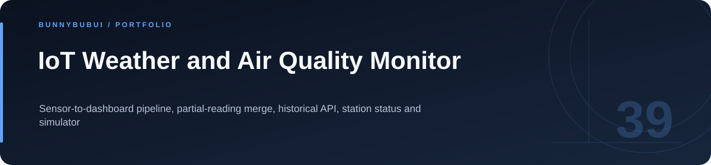
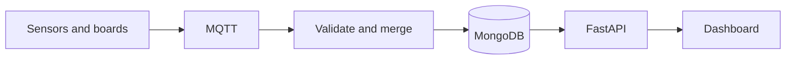

<p align="center">
  
</p>

<h1 align="center">IoT Weather and Air Quality Monitor</h1>

<p align="center">Sensor-to-dashboard pipeline, partial-reading merge, historical API, station status and simulator</p>

<p align="center">
       
</p>

<p align="center"><a href="#overview">ภาพรวม</a> · <a href="#features">ความสามารถ</a> · <a href="#start">เริ่มใช้งาน</a> · <a href="#structure">โครงสร้าง</a> · <a href="#validation">ตรวจสอบงาน</a></p>

<a id="overview"></a>

## ภาพรวม

ระบบติดตามสภาพอากาศและคุณภาพอากาศ รับข้อมูลจากอุปกรณ์ผ่าน MQTT รวมค่าจากเซนเซอร์ เก็บลง MongoDB และให้บริการผ่าน FastAPI กับ dashboard

<a id="features"></a>

## ความสามารถที่มีใน source

| ส่วนงาน | รายละเอียด | อ้างอิง |
|---|---|---|
| **Sensor messages** | รับข้อความจากอุปกรณ์ผ่าน MQTT | [ดู source](esp32/weather_station.ino) |
| **Collector** | ตรวจและรวมข้อมูลบางส่วนก่อนบันทึก | [ดู source](collector/collector.py) |
| **REST API** | สถานี ค่าล่าสุด ข้อมูลย้อนหลัง และสถานะ | [ดู source](webapp/app.py) |
| **Simulator** | สร้างข้อมูลสาธิตโดยไม่ต้องต่อบอร์ด | [ดู source](tools/simulate_station.py) |

### เส้นทางการทำงาน



<a id="start"></a>

## เริ่มต้นใช้งาน

**สิ่งที่ต้องมี:** Docker พร้อม Compose; simulator ใช้ Python และ paho-mqtt

```sh
cp .env.example .env
docker compose up -d --build
docker compose ps

# Optional: simulate a station from your host
python -m pip install paho-mqtt
python tools/simulate_station.py
```

เปิด dashboard ที่ http://localhost:8000 การตั้งค่าปัจจุบัน bind MQTT/MongoDB กับ localhost; เมื่อต่อบอร์ดจริงต้องกำหนดการเข้าถึง MQTT จาก LAN ให้ตรงกับเครื่องและเครือข่ายที่ใช้

<a id="configuration"></a>

## การตั้งค่า

ตัวอย่างค่าตั้งค่าอยู่ในไฟล์ต่อไปนี้ คัดลอกไปยังชื่อไฟล์ local ที่โปรเจกต์อ่านและกำหนดค่าของเครื่องที่ใช้

| ไฟล์ตัวอย่าง | ตัวแปรสำคัญ |
|---|---|
| [.env.example](.env.example) | `MQTT_BROKER`, `MQTT_PORT`, `MQTT_TOPIC_SUB`, `MONGO_URL`, `DB_NAME`, `COLLECTION_NAME` … |

<a id="api"></a>

## API โดยย่อ

| Method | เส้นทาง | หน้าที่ |
|---|---|---|
| GET | `/api/stations` | รายชื่อสถานี |
| GET | `/api/stations/{id}/latest` | ค่าล่าสุดและสถานะ |
| GET | `/api/stations/{id}/history?limit=100` | ข้อมูลย้อนหลัง |

<a id="structure"></a>

## โครงสร้างที่ควรเริ่มอ่าน

| ตำแหน่ง | หน้าที่ |
|---|---|
| [esp32/](esp32) | firmware ตัวอย่าง |
| [collector/](collector) | ตัวรับข้อมูล MQTT |
| [webapp/](webapp) | API และ dashboard |
| [mqtt/](mqtt) | configuration ของ broker |
| [tools/](tools) | เครื่องมือสาธิต |

<a id="validation"></a>

## คำสั่งและผลตรวจ

repository นี้ไม่ได้กำหนดชุด automated tests สำหรับทุก flow; ตรวจผลจาก entry point และข้อมูลสาธิตที่เกี่ยวข้อง

ดู [ผลตรวจที่บันทึกไว้](docs/VALIDATION.md) สำหรับขอบเขตการทดสอบรอบเตรียมพอร์ต

<a id="reading"></a>

## อ่านต่อ

- [คู่มือรายละเอียดเดิม](docs/LAB_GUIDE.md)
- [บันทึกการเตรียม source](docs/CLEANUP.md)


---

<p align="center"><a href="https://github.com/BunnyBubui">BunnyBubui</a> · <a href="https://github.com/BunnyBubui/test">Software Portfolio</a></p>
